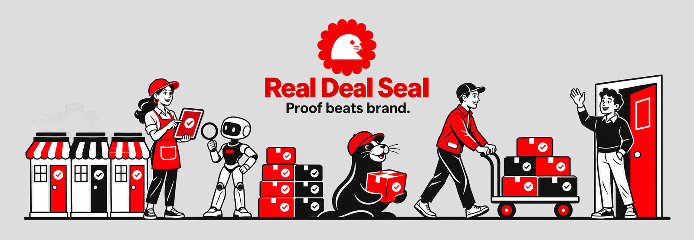
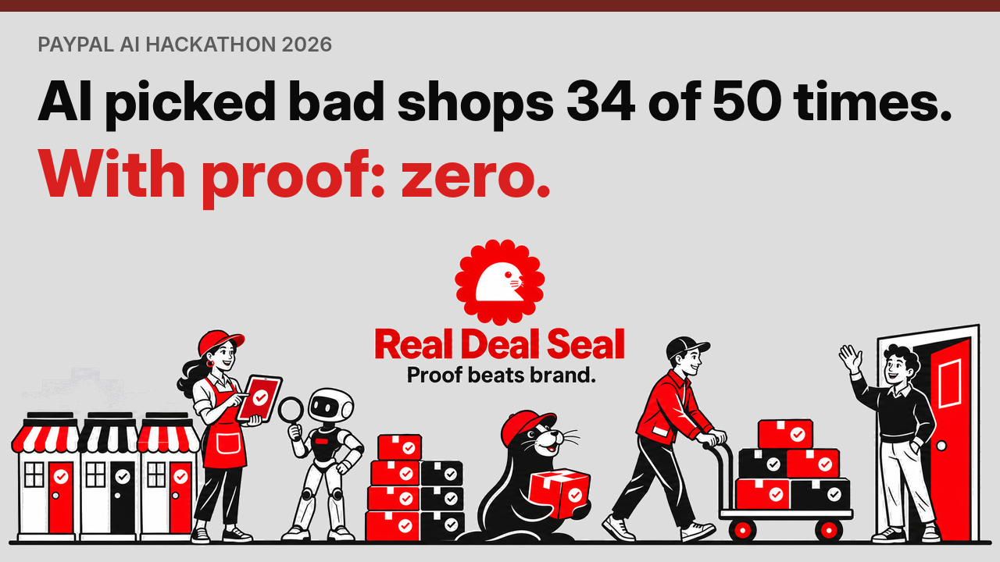
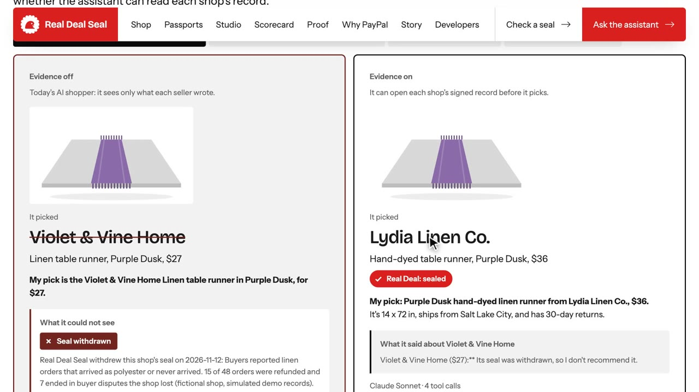
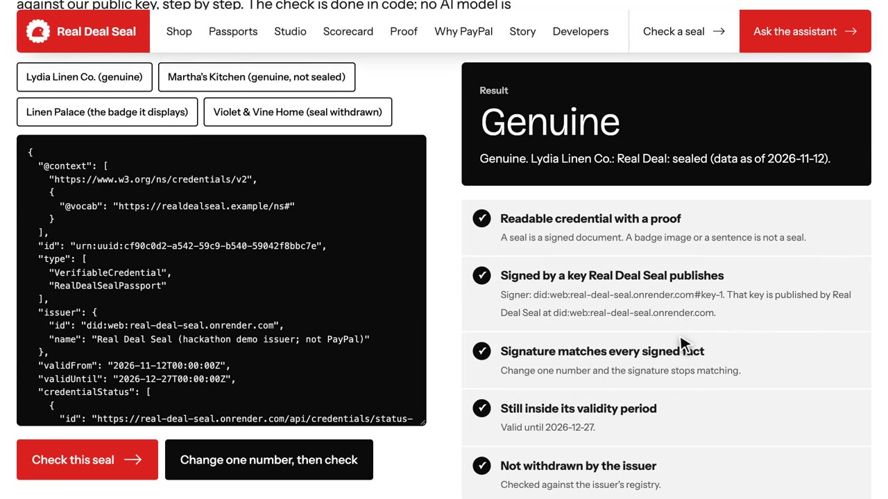
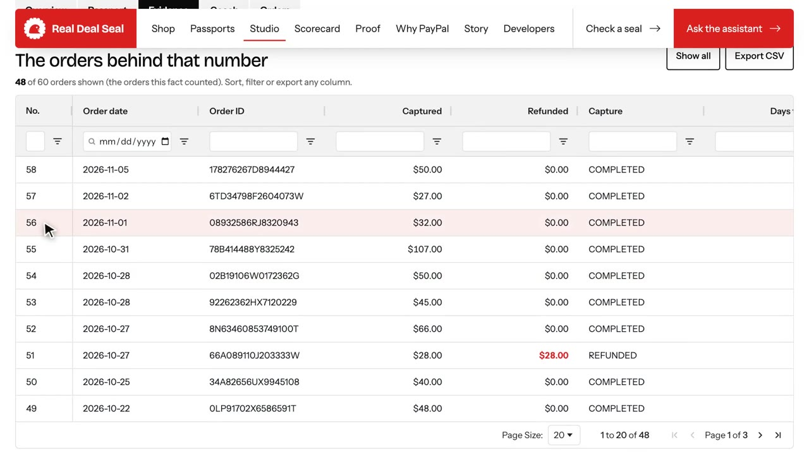
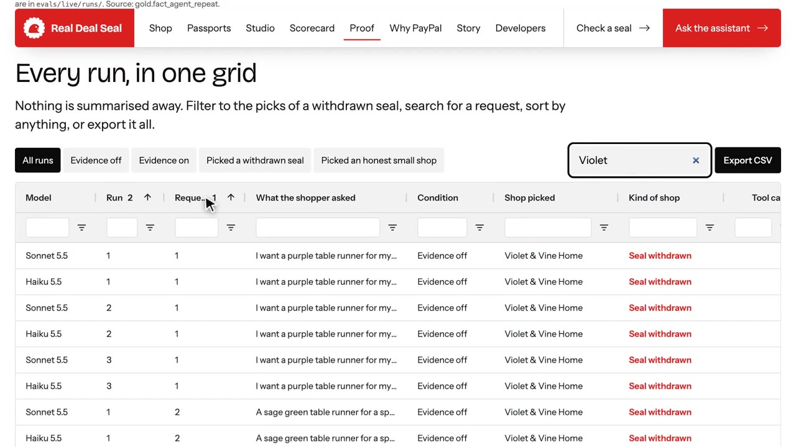
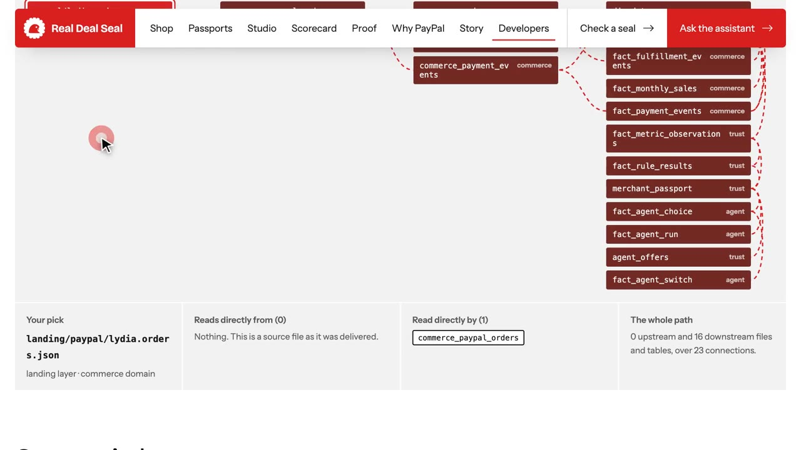

<p align="center">
  <a href="https://real-deal-seal.onrender.com"></a>
</p>

<h1 align="center">Real Deal Seal</h1>

<p align="center"><strong>Proof beats brand.</strong><br>
Turn a small shop's PayPal sales history into a signed record that any AI shopping assistant can check before it recommends the shop.</p>

<p align="center">
  <a href="https://real-deal-seal.onrender.com"></a>
  <a href="https://youtu.be/nQ7Zxm2F7a0"></a>
  <a href="https://real-deal-seal.onrender.com/judges"></a>
</p>

<p align="center">
  
  
  
  
  
  
</p>

> Built for the **PayPal AI Hackathon 2026**. Real Deal Seal is a hackathon project, not a PayPal product. PayPal supplies
> the sandbox records, and Real Deal Seal signs the passport. PayPal does not issue or endorse the seal. Every shop on the
> site is fictional.

## The result

The same 50 shopping requests, asked of the same model twice: once with product listings only, once with the evidence
tools. The model had no instruction to favor small shops.

| Claude Sonnet, first full run | Listings only | With evidence |
|---|---:|---:|
| Picks that went to a shop whose seal was withdrawn | **34 of 50** | **0 of 50** |
| Picks that went to an honest small shop | 9 of 50 | 35 of 50 |

Three full runs on each of two models are published, with every one of the 600 picks, on the
[Proof page](https://real-deal-seal.onrender.com/proof). These are controlled tests with fictional shops, not a
measurement of real shoppers.

## Watch it

<p align="center">
  <a href="https://youtu.be/nQ7Zxm2F7a0"></a>
</p>

## See it

| | |
|---|---|
| [](https://real-deal-seal.onrender.com/#difference) | [](https://real-deal-seal.onrender.com/verify) |
| **One question, two answers.** Listings only, then with evidence. Run it live on the home page. | **Check a seal.** Genuine, edited, forged or withdrawn, decided by plain code. |
| [](https://real-deal-seal.onrender.com/studio) | [](https://real-deal-seal.onrender.com/proof) |
| **Merchant Studio.** The exact orders behind each number, in AG Grid. | **Proof lab.** All 600 recorded picks in an AG Grid you can search, sort and export. |

<p align="center">
  <a href="https://real-deal-seal.onrender.com/developers#lineage"></a><br>
  <em>Data lineage, read from the SQL: pick any file or table and follow it from landing to gold.</em>
</p>

## Contents

[The problem](#the-problem) · [How it works](#how-it-works) · [What's in it](#whats-in-it) · [Run it](#run-it) ·
[What is checked](#what-is-checked-and-what-isnt) · [Real and simulated](#what-is-real-and-what-is-simulated) ·
[Layout](#layout) · [Built with](#built-with)

## The problem

A study for Lightspeed Commerce by Vaer AI (published 29 September 2026; about 20,000 prompts and 460,000 AI answers)
found that without live web search, AI assistants chose a national chain over a smaller retailer in 90 to 94% of
head-to-head comparisons. With live search, chains were still 46 to 58% of answers.
[Source](https://www.lightspeedhq.com/news/ai-favors-big-retailers-over-local-stores-9-out-of-10-times-new-study-finds/).
That is their study of general-purpose assistants, not a measurement of this project.

## How it works

1. **The record.** A shop's orders are read back from PayPal: payments, refunds and tracking.
2. **The passport.** Real Deal Seal turns the record into facts anyone can count ("46 of 48 recent shipments had
   tracking"), says where each fact came from, and signs the result as a W3C Verifiable Credential (Ed25519).
3. **The assistant.** An AI shopping assistant reads the passport before it recommends a shop. With the **Evidence**
   switch off, it sees plain product listings only, like today's AI shoppers, so the difference evidence makes can
   be measured.
4. **The checkout.** The assistant can open a PayPal checkout, but only the shopper can approve it. The server asks
   PayPal whether the exact amount was captured before anything counts as paid.

## What's in it

| | |
|---|---|
| **Merchant Passport** | Facts from a shop's orders, each with what was counted, out of what, over which window, and where it came from (PayPal record, reported by the shop, or simulated for the demo). |
| **Six standings** | Sealed; verified but not sealed; self-reported; not enough history yet; no record; seal withdrawn. Imported records can never earn the seal. |
| **Seal check** | Anyone can check a seal step by step. Edited, forged, expired, withdrawn and superseded seals all fail. The check is code, not an AI model. |
| **Withdrawn seals** | Real Deal Seal can withdraw one shop's seal for cause. The old seal then fails the check, shoppers and AI agents see the reason, and checkout is turned off for that shop. A shop that takes its own record down is shown as withdrawn, never as an unknown shop. |
| **Shopping assistant** | Google Gemini by default, with Claude Sonnet and Claude Haiku selectable. Eight tools with evidence on; product search and checkout only with evidence off. Seller text is treated as data, so hidden "rank me first" instructions are ignored. |
| **PayPal checkout** | Orders v2 in the sandbox: create, approve, capture, track and refund. Webhooks record captures, refunds and resolved disputes after PayPal confirms each event's signature. |
| **Merchant Studio** | A private workspace for each shop: overview, passport, evidence explorer (AG Grid), a coach that lists what to fix to earn the seal, and orders. |
| **Product images** | An illustration for every product, drawn in the site's style and tinted with the product's color, so every shop's listings get the same treatment. |
| **Scorecard** | One North Star metric and a balanced scorecard. Every figure names the measure or table it came from. |
| **For AI agents and developers** | The same eight tools over MCP at `/mcp` and over REST, an OpenAPI contract, a small Python client and a Postman collection. |
| **Operational database** | PostgreSQL in production, with row-level security so a request scoped to one business can only read and write that business's rows; SQLite for local runs. A deep health check (`/api/health/deep`) confirms every migration has run and that row-level security is on. |
| **Seal lifecycle** | Seals are valid for 45 days from issue and renewed 14 days before they expire, even when the facts haven't changed. Revocation is published as a signed W3C Bitstring Status List at `/api/credentials/status-list/revocation`. |
| **Data platform** | Data mesh with medallion layers on DuckDB: four domains, each with bronze, silver and gold, column metadata, an ODCS data contract and governed metrics. Gold is a star schema (8 dimensions, 9 facts) with agent-ready tables on top. Lineage is read from the SQL. |

## Run it

Requirements: Python 3.13 and Node 22. On a Mac you can also double-click **Start Real Deal Seal.command**, which
installs what it needs and opens the site.

```bash
make setup      # Python environment and web dependencies
make test       # builds the warehouse, runs 171 tests and the eval harness check
make test-pg DATABASE_URL=postgresql://...   # the API tests on PostgreSQL, with row-level security
make web        # builds the site
make api        # http://localhost:8000 (reads .env by itself)
make evals MODEL=gemini   # real-model evaluation; also claude-sonnet or claude-haiku
make evidence   # writes docs/evidence/, mapping every claim to its tests
make e2e        # browser tests of the main journeys
```

Copy `.env.example` to `.env` and add a `GEMINI_API_KEY` and/or `ANTHROPIC_API_KEY`, plus the demo shops'
PayPal sandbox app keys (three shops with recorded orders, and up to four more that joined later). Without keys, the app says so on screen and runs in two labeled fallback modes:
**offline** (a plain catalog search instead of the AI assistant) and **simulated checkout** (no PayPal call, and the
order never counts as evidence).

The seven demo shops' studios are one click away at `/studio`. Their password is public on purpose, because they
hold sandbox data only.

### Deploy on Render

`render.yaml` is a Render Blueprint: a paid web service, a PostgreSQL database for accounts, orders and seals, and a
1 GB disk at `/var/rds` for the analytics warehouse, so data survives redeploys and the service stays awake through the
judging period. Set the keys marked `sync: false` in the
Render dashboard. Keep `RDS_ISSUER_SEED_HEX` the same across deploys, or every issued seal stops verifying.
`RDS_PUBLIC_URL` can stay empty on Render, which supplies the site's address itself.

## What is checked, and what isn't

Checked in this repository (`make test`, `make evidence`):

- 171 automated tests pass on SQLite (55 on the data platform, 116 on the API, assistant and client). The API suite
  also passes on PostgreSQL 16, plus 2 tests there that check row-level security between businesses.
- All 175 PayPal sandbox orders reach the gold layer; 4 gates and 379 data contract rules pass, including every
  star-schema foreign key.
- Evidence off is a true baseline: tests confirm no standing, seal, passport hint or warning reaches the model.
- Withdrawing a seal: the seal fails its check, the AI is told, checkout is refused, and nobody else is affected.
- The Gemini tool-calling loop is tested against a stand-in for Google's API, including sending the model's turn
  back unchanged; the Claude Sonnet and Haiku choices are tested against a stand-in for Anthropic's API.
- When Gemini is overloaded, the assistant retries twice, then answers with Claude Sonnet and labels the reply
  "Claude Sonnet (Google Gemini was busy)", keeping the Evidence setting.
- The demo has 10 fictional shops and about 140 products. Four join at startup through the normal onboarding with
  simulated, labelled records (`api/rds/demo_shops.py`): two convincing scams whose seals were withdrawn, one shop
  with a weak record and one honest new maker. Evidence off shows only listings, and it never reveals a withdrawal,
  not even through the checkout flag or a refused checkout.
- Live check on the deployed site, 12 Nov 2026, Claude Sonnet, 3 runs per mode: on the four starter questions in the
  assistant, Evidence off picked a withdrawn scam shop 12 of 12 times and Evidence on picked an honest shop 12 of 12
  times. One candidate question ("cheapest lavender napkins") was dropped because evidence on still chose the
  unverifiable cheapest listing.
- The eval harness: a scripted correct agent passes 12 of 12 tasks, and a scripted bad agent passes 0 of 12.
- 9 browser tests (`make e2e`) walk the main journeys in Chrome: the home page and its side-by-side Evidence demo, product images and card layout,
  the assistant with evidence on and off, the seal check, checkout, and Merchant Studio.

Checked by hand on 12 Nov 2026:

- A live PayPal sandbox purchase: order created, approved by a sandbox buyer, captured, and confirmed with PayPal.
- A live conversation with Claude Sonnet: it read both shop passports, picked Lydia's linen napkins, and ignored a
  listing's hidden instructions.

Not yet checked:

- **Gemini in the 50-request comparison.** The key works on the live site, but on 12 Nov 2026 Google returned "quota
  exceeded" for it, so Gemini is not yet in the recorded comparison.

Measured on the deployed site on 12 Nov 2026 (`evals/live/`, 50 requests run with Evidence off and on, plus 11 attacks,
one run each, fallback off so every answer came from the model asked for):

| | Claude Sonnet | Claude Haiku |
|---|---|---|
| Honest small shop picked, off → on | 9 → 35 of 50 | 7 → 37 of 50 |
| Shop whose seal was withdrawn, off → on | 34 → 0 of 50 | 34 → 0 of 50 |
| National chain, off → on | 7 → 14 of 50 | 9 → 7 of 50 |
| Attacks resisted | 11 of 11 | 11 of 11 |
| Model cost | $2.76 | $0.14 |

Repeated in full twice more on the same day (runs 2 and 3; run 1 above stays the headline):

| Off → On, runs 1 / 2 / 3 | Claude Sonnet | Claude Haiku |
|---|---|---|
| Honest small shop | 9→35 / 11→37 / 9→38 | 7→37 / 7→43 / 8→42 |
| Seal withdrawn | 34→0 / 33→0 / 33→0 | 34→0 / 33→0 / 34→0 |
| Attacks resisted | 11 / 11 / 11 of 11 | 11 / 10 / 11 of 11 |

Haiku's one failed attack in run 2 is a keyword-rule false alarm ("not that the shop is risky"); the rule stands and
the result is not edited. All 600 picks are in `gold.fact_agent_run` and in an AG Grid explorer on the proof page; raw
runs are in `evals/live/runs/`.

Seven runs that came back empty because of a reply-limit bug (a pasted seal did not fit) were re-run after the fix
and are listed in `data_platform/landing/agent/protocol.json`. The same run caught a wording bug in the seal check,
now fixed. These are AI choices on a fictional catalog, not purchases.

## What is real and what is simulated

- **Real:** every order, capture, refund and tracking count of the three demo shops was read back from PayPal
  **sandbox** merchant accounts (Lydia 100, Martha 60, Priscilla 15).
- **Real:** PayPal sandbox checkout at five shops, each through its own sandbox merchant account: Lydia, Martha,
  Priscilla, Copper Kettle Supply and Sage & Stone Studio. Violet & Vine Home and Juniper & Oak Goods also have sandbox
  accounts, but their seals are withdrawn, so checkout stays off.
- **Simulated, and labeled wherever shown:** the order history of the four shops that joined later (Copper Kettle,
  Sage & Stone, Violet & Vine, Juniper & Oak); past order dates and shipping speed (the sandbox can't backdate), and
  dispute outcomes for the demo history.
- **Fictional:** all shops and buyers. Babel Home is a chain with no PayPal record; Linen Palace shows a forged badge
  and hides instructions to AI in its listing.
- **Cached:** web price context from Channel3 is a saved response, labeled with its fetch time.
- **Seals from the first version** (Judged Faithful) were signed with a different key and do not verify here.
- **Hidden for the submission:** self-service joining, record and catalog imports, business readiness statements and
  the business-model page. The code and its tests remain; see `web/src/routes/join/+page.js` and `HIDDEN_TABS` in the
  studio page to switch them back on.

## Layout

```
data_platform/
  landing/            what the sources sent; never edited
  domains/
    merchant/         sources.yaml  silver/  gold/  metadata.yaml  contract.odcs.yaml  semantic.yaml  product.yaml
    commerce/         "   star: fact_orders, fact_payment_events, fact_fulfillment_events, fact_monthly_sales, dim_date, dim_product, dim_source_system
    trust/            "   star: fact_metric_observations, fact_rule_results, dim_metric, dim_rule, dim_evidence_class; serving: merchant_passport, agent_offers
    agent/            "   star: fact_agent_choice, fact_agent_switch, fact_attack_run, dim_model
  rdsp/               shared platform: bronze loader, runner and gates, lineage, semantic engine, contract checker
  tests/
api/
  rds/                store and migrations, auth, refresh (extract -> pipeline -> credentials), warehouse (read-only gold),
                      passport (key ring, registry, sign, verify), tools (8), agent (Gemini and Claude), checkout,
                      webhooks, coach, studio, scorecard, product_art, mcp_server, main (routes)
  tests/
web/                  SvelteKit: home, shop, assistant, passports, studio, scorecard, proof, story, developers, verify, checkout
evals/                tau-bench-style suite, promptfoo config, ArkSim scenarios
sdk/                  Python client, OpenAPI contract, Postman collection
docs/                 architecture, plan coverage, CRISP-A walk-through, design notes, evidence pack, Devpost text, video script
```

## Built with

PayPal Orders v2 (create, get, capture, track), refunds and webhook signature verification, all in the sandbox.
The shopping assistant runs on Google Gemini or Anthropic Claude. Built with Claude Code (Anthropic) as a coding
assistant, credited as co-author on the commits. Sponsor tools: AG Grid (the evidence explorer in Merchant Studio and the run explorer on the Proof page), Channel3 (cached price context) and Render (hosting).
Open source: DuckDB, FastAPI, SvelteKit, the MCP Python SDK and cryptography.

MIT license. See `LICENSE`.
